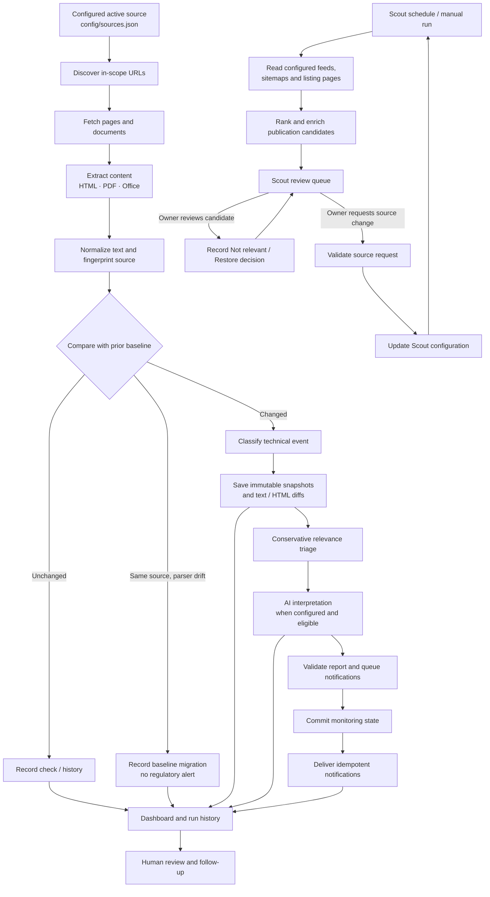

<p align="center">
  
</p>

<p align="center">
  <strong>Evidence-first regulatory change monitoring and publication discovery.</strong><br />
  Discover what changed, preserve the proof, and help reviewers understand why it may matter.
</p>

<p align="center">
  <a href="https://github.com/GauravDarwesh/ChangeSentinel/actions/workflows/ci.yml"></a>
  <a href="https://github.com/GauravDarwesh/ChangeSentinel/actions/workflows/regulatory-monitor.yml"></a>
  <a href="https://gauravdarwesh.github.io/ChangeSentinel/"></a>
</p>

<p align="center">
  <a href="https://gauravdarwesh.github.io/ChangeSentinel/">Open dashboard</a> ·
  <a href="#how-it-works">How it works</a> ·
  <a href="#scout-discover-new-regulatory-publications">Scout discovery</a> ·
  <a href="#run-it-locally">Development</a>
</p>

---

## What is ChangeSentinel?

ChangeSentinel is a configuration-driven regulatory monitoring and review system. It discovers public pages and linked documents within explicitly defined source boundaries, fetches and extracts their contents, compares observations against trusted baselines, preserves evidence for meaningful changes, and uses AI to help explain potential regulatory significance.

It is more than a crawler: the repository combines a scheduled monitoring engine, a publication-discovery workflow called **Scout**, durable change evidence and run history, notifications, and a browser-based review console. GitHub Actions provides the automation, so the core monitor does not require a permanently running server.

### Core principles

- **Deterministic detection, AI interpretation.** Hashes and normalized content decide whether content changed. AI does not decide whether a page technically changed.
- **Evidence before explanation.** Snapshots, fingerprints, and diffs let a reviewer inspect the source material behind an assessment.
- **Bounded discovery.** Each monitor has configured hosts, seed URLs, and scope rules. Scout channels also declare permitted hosts and discovery paths.
- **No silent baseline resets.** Extraction-version changes and extraction drift are recorded separately from genuine source changes when the source itself is unchanged.
- **Human-controlled expansion.** Scout surfaces candidate publications for review; a discovered page does not automatically become a monitored source.
- **Operational resilience.** State validation, notification idempotency, a durable outbox, and safeguards around mass URL removals reduce avoidable noise and lost events.

## How it works



The scheduled monitor and Scout solve different problems:

- **Monitoring** checks already configured active sources for changes and creates evidence-backed events.
- **Scout** explores configured publication channels for potentially useful pages that are not yet monitored. Candidates and review decisions are kept separately from monitoring baselines.
- **The dashboard** brings together saved monitoring data and Scout results so a person can inspect the evidence and decide what to do next.

## Monitoring pipeline

### 1. Configuration and discovery

Source definitions live in `config/sources.json`. The engine starts from configured seeds and discovers resources within the source's allowed scope. Active configuration determines what is run; a source described in history or retained as inactive is not automatically monitored.

The active fleet includes two Federal Reserve reporting-forms pilots (overview and recently updated form details), plus individually registered pages and documents such as Federal Reserve/FRB Services reporting materials and OSFI's BCAR materials. The older EBA monitoring configurations are inactive; EBA remains present as a separate Scout discovery profile. The exact active scope is defined by the configuration, not by this summary.

The discovery layer canonicalizes URLs and applies source-specific rules to avoid treating superficial URL differences as separate resources. Discovery results and failures are recorded so an incomplete crawl is not confused with a complete inventory.

### 2. Fetching and document extraction

The fetch and extraction layers turn supported web content into comparable evidence. HTML extraction filters common non-content elements—such as scripts, styles, navigation, footers, and cookie/banner containers—where appropriate. PDF and office-document paths use document extraction tooling, with fallback behavior for supported formats.

The system retains the fetched HTML response separately from normalized extracted text. That distinction allows the dashboard to show the original page/source and compare it with the extracted text used for change detection.

### 3. Normalization and deterministic change detection

Normalized text removes irrelevant formatting differences such as repeated whitespace, empty lines, and Unicode representation differences. A SHA-256 fingerprint of the normalized content is the primary text comparison signal.

Typical event types include:

| Event | Meaning |
| --- | --- |
| `NEW_URL` | A URL appears in the discovered inventory for the first time. |
| `CHANGED_URL` | Normalized extracted content changed. |
| `HTML_SOURCE_CHANGED` | The stable HTML comparison signature changed while extracted text stayed the same. |
| `UNCHANGED_URL` | The content comparison is unchanged. |
| `REMOVED_URL` | A previously monitored URL is absent from a complete discovery result, subject to removal safeguards. |
| `FETCH_ERROR` | The resource could not be fetched successfully. |
| `EXTRACTION_ERROR` | The resource was fetched but could not be converted into usable text. |
| `BASELINE_MIGRATION` | Extracted output changed while the underlying source is proven unchanged, for example after an extractor upgrade or extraction drift. |

The monitor includes safeguards against noisy changes. Rotating Cloudflare challenge metadata is normalized for HTML comparison while raw response evidence is retained. Large sudden URL removals are held for confirmation; browser-only discovery requires absence across consecutive complete crawls before removal is reported. Parser-version changes or extraction drift on byte-identical sources are recorded as baseline migrations rather than regulatory changes.

### 4. Evidence and review

Meaningful events preserve evidence under `data/evidence/`, with snapshots under `data/snapshots/`. Content-addressed HTML snapshots avoid overwriting evidence referenced by older events. Depending on the event, the record can include previous/current fingerprints, extracted-text diffs, formatted HTML-source diffs, and snapshot locations.

Specification files get a row-level reading as well (`regmon/spec_diff.py`): edit-check and validation-rule workbooks are aligned by rule ID, data dictionaries and PDF field-spec tables by field code (MDRM, DPM, measure, formato), XSDs by element path and code list, and XBRL linkbases by assertion. A change then says which rules are new or retired and from when, which logic or messages changed, which checks became blocking, and where the regulator's own "New / Updated / Deprecated" annotation disagrees with what actually changed. `python -m regmon.spec_diff PREV CUR -o report.xlsx` runs the same comparison on two local files and writes an analyst workbook with Impact and comment columns (see `docs/OPERATIONS.md`).

The AI interpretation layer receives candidate change evidence and returns a strict structured assessment with fields for relevance, topic, change type, summary, impact, effective date, affected scope, suggested actions, and rationale. It is instructed to use only the supplied evidence and to state when a value is not established. AI is an aid for triage and explanation—not a substitute for source verification or professional judgment.

### 5. Notifications and durable state

Notifications are sent through [ntfy](https://ntfy.sh/) for eligible relevant changes and configured operational events. Event identifiers prevent duplicate delivery. Notifications are queued in a durable outbox, monitoring state is validated and committed first, and delivery state is recorded afterward so failures can be investigated and retried safely.

Important runtime state includes:

| Path | Purpose |
| --- | --- |
| `data/latest.json` | Latest per-source monitored URL inventory and baseline metadata. |
| `data/report.json`, `data/report.md` | Aggregate latest report. |
| `data/reports/` | Per-source reports. |
| `data/snapshots/` | Saved normalized text and raw HTML snapshots. |
| `data/evidence/` | Event evidence and diffs. |
| `data/history/` | Compact index and full per-run history. |
| `data/notifications.json` | Notification idempotency state. |
| `data/notification-outbox.json` | Durable queue of notifications awaiting delivery. |

## Scout: discover new regulatory publications

Scout is a separate, configuration-driven discovery workflow. Its profiles in `config/scout.json` describe regulators, regions, permitted hosts, languages, and discovery channels such as sitemaps, feeds, and listing pages. Listing channels can use bounded pagination and depth-limited exploration. Per-regulator request, time, response-size, and delay limits constrain discovery.

Scout runs weekly and can also be dispatched manually for all active profiles or a selected regulator. It records sweep history, candidate evidence, and review decisions under `data/scout/`. The dashboard's Scout view shows candidate pages and the signals behind the discovery decision.

Owner-initiated dashboard requests can record **Not relevant** or **Restore** decisions, or request a source/profile change. The workflows validate requests before updating Scout state/configuration. A newly discovered candidate is not silently promoted into the monitoring engine: source expansion remains an explicit, reviewable action.

## Dashboard and review console

The GitHub Pages console is a lightweight, dependency-conscious frontend built around `index.html`, `dashboard.js`, `dashboard-lib.js`, and `dashboard-v2.html`. Monitoring JSON is read from the repository, so data-only monitoring commits can update the dashboard without rebuilding the static site.

The workspace includes:

- **Overview:** scan history / heatmap, per-page activity, current status, and next-scan context.
- **Changes:** chronological change events, AI assessments, sentence/word-level redlines, and links to text and HTML diffs.
- **Pages:** per-page history, saved page or document, extracted text, fetched HTML source, and fingerprints.
- **Runs and Alerts:** run outcomes, notification queue, and delivery history.
- **Scout:** publication candidates, discovery evidence, coverage, and review actions.
- **Monitor health:** source-level health and recent operational failures.
- **Calendar:** regulatory dates and team follow-up planning.
- **Ask Sentinel:** a dashboard assistant that answers questions against available monitoring context through a Supabase Edge Function and OpenRouter model.

The console is designed for desktop and mobile layouts. Its pure presentation logic is separated into `dashboard-lib.js` and has automated tests.

## Automation and quality gates

GitHub Actions orchestrates monitoring, testing, discovery, and publishing.

| Workflow | Responsibility |
| --- | --- |
| `RegMonitor CI` (`.github/workflows/ci.yml`) | Unit/regression tests, Python compilation, extraction checks, Edge Function type checks/tests, and dashboard browser smoke tests. |
| `Regulatory Monitor` | Scheduled or manual source scan, extraction, comparison, evidence/report generation, state validation, commit, and notification delivery. |
| `AI Smoke Test` | Non-mutating check of the configured OpenRouter integration and its structured JSON contract. |
| `Scout` | Scheduled or manually requested publication discovery and Scout-state persistence. |
| `Scout Review Decision` | Processes owner-submitted Scout review decisions. |
| `Scout Source Request` | Validates and applies owner-submitted Scout source/profile requests. |
| `Deploy Monitoring Console` (`pages.yml`) | Publishes the dashboard to GitHub Pages. |

The scheduled scan wakes every six hours and can also be triggered manually; each monitor may ask to be checked less often, on some weekdays or within local hours (see the scan schedules section of `docs/OPERATIONS.md`). Scout has its own weekly schedule. Check the workflow files for the authoritative schedules and required secrets.

## Run it locally

Use Python 3.13, then install the repository's pinned dependencies:

```bash
git clone https://github.com/GauravDarwesh/ChangeSentinel.git
cd ChangeSentinel
python3.13 -m venv .venv
source .venv/bin/activate
python -m pip install --extra-index-url https://download.pytorch.org/whl/cpu -r requirements.txt
```

Run the test suite:

```bash
python -m unittest discover -s tests -p "test*.py" -v
python -m compileall -q regmon
```

Some extraction integration checks require system OCR tooling; CI installs Tesseract and exercises document extraction against synthetic and saved golden-corpus inputs. The dashboard can be served via a local static HTTP server or the configured GitHub Pages deployment.

Do not run a production scan or commit generated monitoring state unintentionally while experimenting. Review the workflow and configuration before using commands that write under `data/`.

## Configuration and secrets

- Configure monitoring scope in `config/sources.json`.
- Configure Scout discovery profiles in `config/scout.json`.
- Store provider credentials as GitHub Actions or Supabase secrets; do not commit credentials into source files or configuration.
- AI interpretation requires the configured OpenRouter API secret. Notifications require the configured ntfy settings.
- Ask Sentinel uses a Supabase Edge Function and OpenRouter; the function contains origin checks, request limits, bounded context/output, and server-side credential handling.
- Calendar and assistant features depend on their deployed Supabase functions and configured environment. A locally checked-out repository alone does not imply those remote services are configured.

## Repository map

```text
.
├── config/
│   ├── sources.json          # Active/inactive monitoring source definitions
│   └── scout.json            # Scout regulator profiles and discovery channels
├── regmon/                   # Monitoring engine, extraction, comparison, AI, state, Scout
├── scripts/                  # State commits, extraction checks, dashboard smoke tests
├── tests/                    # Python and dashboard/Edge Function regression tests
├── supabase/functions/       # Ask Sentinel, calendar, and page-reader APIs
├── data/                     # Baselines, reports, evidence, history, Scout state
├── index.html                # Main dashboard shell
├── dashboard.js              # Dashboard interactions and rendering
├── dashboard-lib.js          # Pure dashboard logic and formatting
└── .github/workflows/        # CI, monitoring, Scout, and Pages automation
```

## Scope and limitations

ChangeSentinel monitors public sources configured in the repository; it is not a guarantee that every publication from every regulator is discovered. Coverage depends on source configuration, publisher site structure, crawl limits, fetchability, and extraction quality. A technically detected change may not be relevant, and an AI assessment can be incomplete or wrong. Review the preserved source and diff before acting on an assessment.

An inactive source is not scheduled for routine monitoring. Scout candidates are suggestions until reviewed. The project is designed to make evidence and uncertainty inspectable rather than claim perfect coverage or automated regulatory compliance.

## Licensing note

There is currently no `LICENSE` file in the repository. Do not assume the code is available for reuse or redistribution under an open-source license until the repository owner adds or clarifies licensing terms.
